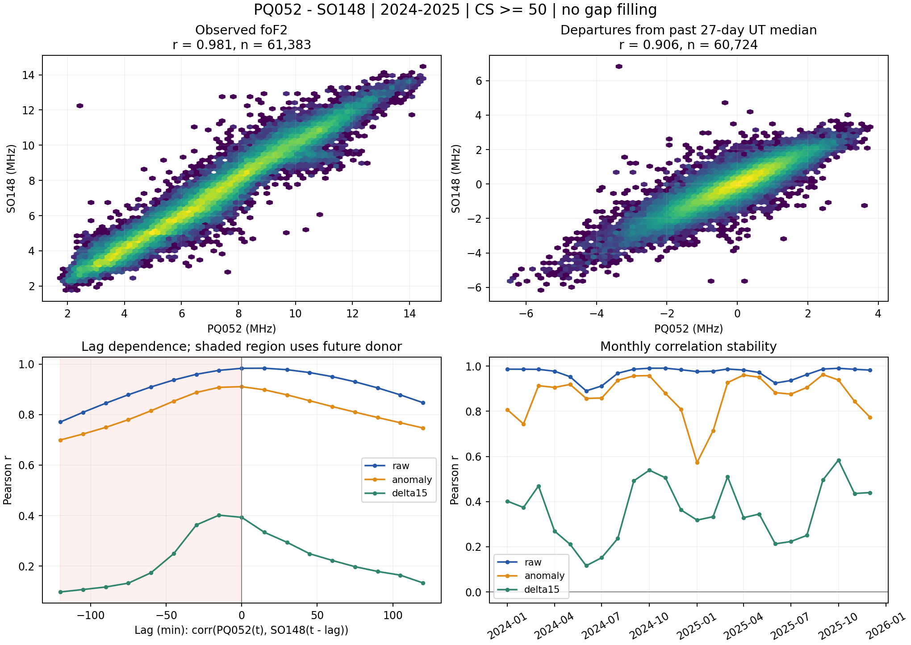
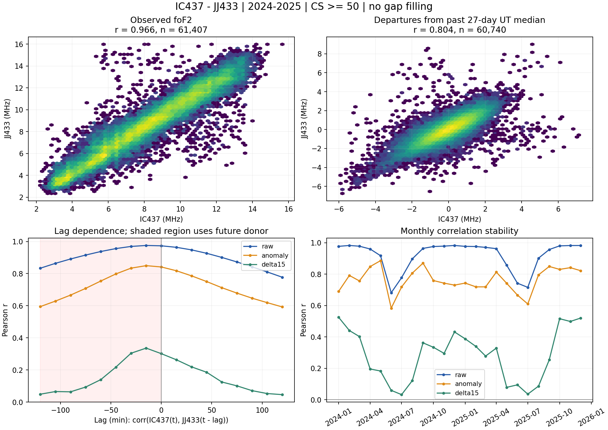

# Предварительная диагностика близких станций, 2024–2025

Статус: выполнена описательная диагностика. Обучение моделей, расчёт прогнозов и ошибок MAE не запускались.

Период: 01.01.2024–31.12.2025, UTC, включая 29 февраля. Все измерения 2026 года исключены. Исходные ответы GIRO проверены по SHA-256 и коду станции. Принимаются конечные foF2 0,5–25 МГц и CS ≥ 50, включая ручную обработку CS=999. CS=-1 и неизвестное качество исключены. После фильтрации берётся среднее внутри каждого 15-минутного интервала; пропуски не заполняются.

## Покрытие

| Станция | 2024, % | 2025, % | Всего, % | Наибольший пропуск, ч |
|---|---:|---:|---:|---:|
| PQ052 | 93.76 | 97.38 | 95.57 | 102.50 |
| SO148 | 90.28 | 92.25 | 91.27 | 362.25 |
| IC437 | 94.87 | 90.71 | 92.79 | 42.00 |
| JJ433 | 94.25 | 91.16 | 92.71 | 5.75 |

| Пара | Расстояние, км | Общие интервалы | Совместное покрытие, % | Наибольший разрыв совместного ряда, ч |
|---|---:|---:|---:|---:|
| PQ052_SO148 | 308.0 | 61383 | 87.47 | 362.25 |
| IC437_JJ433 | 425.6 | 61407 | 87.50 | 42.00 |

Разрыв совместного ряда означает отсутствие наблюдений хотя бы одной станции. Корреляции относятся к одновременно доступным наблюдениям; пропуски не обязательно случайны.

## Корреляции

| Пара | Представление | Pearson r | 95% ДИ r | Spearman ρ | Общие интервалы |
|---|---|---:|---|---:|---:|
| PQ052_SO148 | Исходный foF2 | 0.9814 | [0.9790; 0.9834] | 0.9835 | 61383 |
| PQ052_SO148 | Отклонения от прошлой медианы | 0.9062 | [0.8901; 0.9196] | 0.8965 | 60724 |
| PQ052_SO148 | Изменения за 15 минут | 0.3633 | [0.3326; 0.3924] | 0.4270 | 60136 |
| IC437_JJ433 | Исходный foF2 | 0.9659 | [0.9598; 0.9705] | 0.9683 | 61407 |
| IC437_JJ433 | Отклонения от прошлой медианы | 0.8043 | [0.7827; 0.8238] | 0.8184 | 60740 |
| IC437_JJ433 | Изменения за 15 минут | 0.2573 | [0.2213; 0.2935] | 0.3679 | 57364 |

Исходная корреляция может включать общий суточный и сезонный ход. Для отклонений каждая станция сравнивается с медианой того же UTC-интервала за предыдущие 27 календарных дней, минимум 7 доступных значений. Текущий день и будущее в базовую линию не входят. Это локальная оценка фона, а не физическая модель ионосферы. Разности вычисляются только между соседними исходными интервалами, без переходов через пропуски.

Доверительные интервалы Pearson получены парным круговым bootstrap календарных 7-дневных блоков (2000 повторов). Они отражают неопределённость при выбранной длине блока, но не доказывают причинность и не корректируют все множественные сравнения. Наивные p-value для независимых точек не используются.

## Изменение связи между годами

| Пара | Представление | r за 2024 | r за 2025 |
|---|---|---:|---:|
| PQ052_SO148 | Исходный foF2 | 0.9820 | 0.9809 |
| PQ052_SO148 | Отклонения от прошлой медианы | 0.9078 | 0.9053 |
| PQ052_SO148 | Изменения за 15 минут | 0.3492 | 0.3821 |
| IC437_JJ433 | Исходный foF2 | 0.9678 | 0.9638 |
| IC437_JJ433 | Отклонения от прошлой медианы | 0.8121 | 0.7973 |
| IC437_JJ433 | Изменения за 15 минут | 0.2546 | 0.2599 |

## Помесячная устойчивость

| Пара | Представление | Минимальный r | Максимальный r | Месяцев с r < 0 |
|---|---|---:|---:|---:|
| PQ052_SO148 | Исходный foF2 | 0.8902 | 0.9907 | 0 |
| PQ052_SO148 | Отклонения от прошлой медианы | 0.5728 | 0.9625 | 0 |
| PQ052_SO148 | Изменения за 15 минут | 0.1160 | 0.5840 | 0 |
| IC437_JJ433 | Исходный foF2 | 0.6818 | 0.9829 | 0 |
| IC437_JJ433 | Отклонения от прошлой медианы | 0.5835 | 0.8860 | 0 |
| IC437_JJ433 | Изменения за 15 минут | 0.0325 | 0.5250 | 0 |

## Временные сдвиги

Определение: corr(target(t), donor(t − lag)). Положительный сдвиг использует прошлые наблюдения донора; отрицательный — будущие и не допускается в прогнозных признаках. Внутри каждого профиля сравниваются одинаковые моменты времени, доступные при всех сдвигах −120…120 минут; поэтому r при нуле может отличаться от общей таблицы корреляций. Эта диагностическая маска не применяется к будущей оценке прогноза. Парные оценки на отдельных выборках также сохранены в lag_correlations.csv. Поиск максимума на всём периоде служит только диагностикой: сдвиг нельзя выбирать по этой таблице и затем объявлять 2025 год независимой проверкой.

| Целевая | Донор | Представление | Лучший lag, мин (0…120) | r при нуле | r при лучшем lag |
|---|---|---|---:|---:|---:|
| PQ052 | SO148 | Исходный foF2 | 15 | 0.9834 | 0.9839 |
| PQ052 | SO148 | Отклонения от прошлой медианы | 0 | 0.9107 | 0.9107 |
| PQ052 | SO148 | Изменения за 15 минут | 0 | 0.3930 | 0.3930 |
| SO148 | PQ052 | Исходный foF2 | 0 | 0.9820 | 0.9820 |
| SO148 | PQ052 | Отклонения от прошлой медианы | 0 | 0.9041 | 0.9041 |
| SO148 | PQ052 | Изменения за 15 минут | 15 | 0.3694 | 0.3828 |
| IC437 | JJ433 | Исходный foF2 | 0 | 0.9731 | 0.9731 |
| IC437 | JJ433 | Отклонения от прошлой медианы | 0 | 0.8414 | 0.8414 |
| IC437 | JJ433 | Изменения за 15 минут | 0 | 0.3016 | 0.3016 |
| JJ433 | IC437 | Исходный foF2 | 15 | 0.9754 | 0.9776 |
| JJ433 | IC437 | Отклонения от прошлой медианы | 15 | 0.8398 | 0.8482 |
| JJ433 | IC437 | Изменения за 15 минут | 15 | 0.3175 | 0.3405 |

## Связь со следующим интервалом при известной локальной истории

Частная корреляция target(t+15 min) и donor(t) вычислена через условную ковариацию. В варианте с одним контролем фиксируется target(t); с четырьмя — target(t), target(t−15 min) и прошлые фоновые медианы обеих станций. Это статистическая диагностика, не обучение прогнозной модели и не оценка выигрыша MAE. Результат не учитывает неизвестные реальные задержки публикации донорских измерений.

| Целевая | Донор | Частный r: текущий target | Частный r: четыре контроля | N, четыре контроля |
|---|---|---:|---:|---:|
| PQ052 | SO148 | 0.3645 | 0.2991 | 59885 |
| SO148 | PQ052 | 0.1381 | 0.2808 | 59176 |
| IC437 | JJ433 | 0.1406 | 0.1691 | 56948 |
| JJ433 | IC437 | 0.3895 | 0.3285 | 56650 |

## Устойчивость к фильтру качества

| Пара | Представление | r, CS≥50 | r, CS≥70 | r, CS≥90 |
|---|---|---:|---:|---:|
| PQ052_SO148 | Исходный foF2 | 0.9814 | 0.9835 | 0.9860 |
| PQ052_SO148 | Отклонения от прошлой медианы | 0.9062 | 0.9134 | 0.9162 |
| PQ052_SO148 | Изменения за 15 минут | 0.3633 | 0.4157 | 0.4730 |
| IC437_JJ433 | Исходный foF2 | 0.9659 | 0.9749 | 0.9838 |
| IC437_JJ433 | Отклонения от прошлой медианы | 0.8043 | 0.8489 | 0.8491 |
| IC437_JJ433 | Изменения за 15 минут | 0.2573 | 0.3607 | 0.4578 |

При ужесточении CS меняются и качество, и набор временных интервалов; это проверка чувствительности, а не сравнение на строго одной выборке. Полные объёмы выборок находятся в cs_sensitivity.csv.

## Изменения будущего эксперимента

Протокол shared/protocol/nearby_pairs_2024_2025.json задаёт четыре направления: PQ052←SO148, SO148←PQ052, IC437←JJ433 и JJ433←IC437. У каждой цели ровно один донор из своей пары. Отдельный run_nearby_pairs.py готовит признаки, проверяет причинность, выполняет ежедневный расчёт с продолжением после остановки и сводный анализ. Старые прогнозы и движок не используются. Команды приведены в RUN_NEARBY_PAIRS.md. Подготовка не обучает модели.

Диагностика выполнена на обоих годах по явному запросу. Эти данные уже просмотрены; последующий эксперимент нельзя описывать как полностью слепую подтверждающую проверку. Протокол фиксирует январь–март 2025 года для сравнения окон и апрель–декабрь 2025 года для хронологической оценки; признаки используют заранее заданные исторические лаги. Существующие статьи, результаты и протокол завершённого эксперимента не заменены.

## Воспроизведение и проверки

Команда: `python shared/code/analyze_nearby_pairs.py`. Исходники находятся в `local_data/nearby_pairs_2024_2025/` и не добавляются в Git; SHA-256, относительные пути и источник зафиксированы в sources.json. Выполнены проверки хешей, кодов станций, независимого подсчёта покрытия и средних, временной сетки, исключения 2026 года, отсутствия будущих данных в базовой линии и запрета разностей через пропуски. Прогнозные модели не импортируются и не запускаются.

Первичный источник: [GIRO/DIDBase FastChar](https://giro.uml.edu/didbase/scaled.php). Архивные лучшие значения могут содержать поздние исправления и не доказывают доступность в реальном времени.

